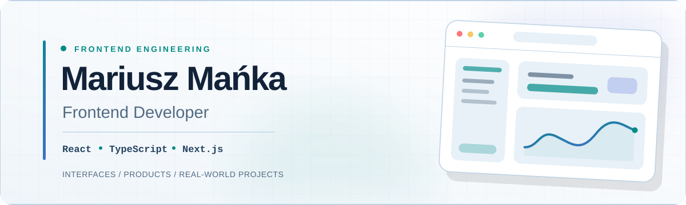
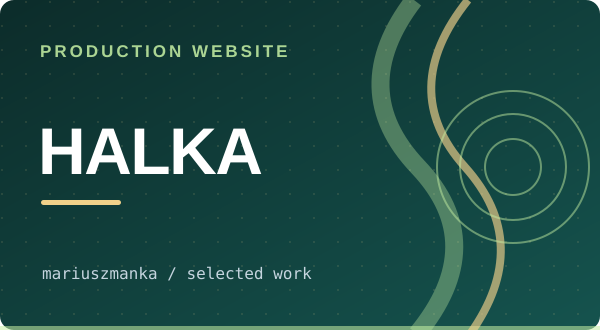
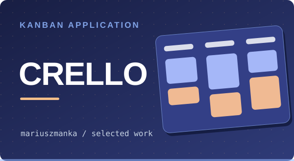
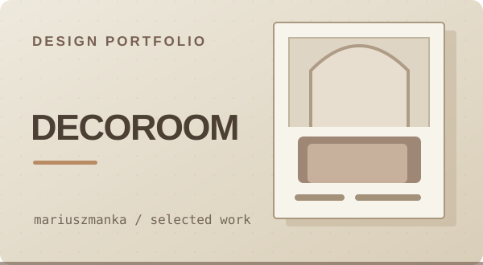

  <picture>
    <source media="(prefers-color-scheme: dark)" srcset="./assets/hero-dark.svg">
    
  </picture>

  <a href="#about">About</a> &nbsp;·&nbsp;
  <a href="#tech-stack">Tech stack</a> &nbsp;·&nbsp;
  <a href="#selected-work">Selected work</a> &nbsp;·&nbsp;
  <a href="https://github.com/MariuszManka?tab=repositories">All repositories</a>

## About

I'm a **frontend developer based in Poland**, building web interfaces and applications with **React and TypeScript**. I enjoy the point where design, code, and product needs come together: making interfaces feel polished while keeping the implementation understandable and maintainable.

I've worked on commercial websites, interactive web applications, and integrations with APIs and content management systems.

## Tech stack

| | Technologies |
| :--- | :--- |
| **Frontend** | `React` · `Next.js` · `TypeScript` · `JavaScript` |
| **UI & styling** | `HTML` · `CSS` · `SCSS` · `Material UI` · `Styled Components` |
| **App development** | `Redux Toolkit` · `React Router` · `REST APIs` |
| **Workflow** | `Git` · `GitHub` · `npm` |

## Selected work

<table>
  <tr>
    <td width="33%" valign="top">
      
      <h3><a href="https://github.com/MariuszManka/halka-lubliniec">Halka Lubliniec</a></h3>
      
A real-world website for a folk ensemble, with an event calendar, digital chronicle, and photo galleries.

      
<code>React</code> <code>TypeScript</code> <code>Next.js</code>

      
<a href="https://halkalubliniec.pl">Live website</a> · <a href="https://github.com/MariuszManka/halka-lubliniec">Code</a>

    </td>
    <td width="33%" valign="top">
      
      <h3><a href="https://github.com/MariuszManka/crello">Crello</a></h3>
      
A Trello-inspired board exploring drag-and-drop interactions, lists, cards, and client-side state.

      
<code>React</code> <code>Redux</code> <code>Styled Components</code>

      
<a href="https://github.com/MariuszManka/crello">Explore the code</a>

    </td>
    <td width="33%" valign="top">
      
      <h3><a href="https://github.com/MariuszManka/decoroom-kinga-wojsa-website">Decoroom</a></h3>
      
A portfolio site for an interior design studio, featuring project galleries and CMS integration.

      
<code>Gatsby</code> <code>React</code> <code>DatoCMS</code>

      
<a href="https://github.com/MariuszManka/decoroom-kinga-wojsa-website">Explore the code</a>

    </td>
  </tr>
</table>

## What I value

**Thoughtful interfaces. Clear components. Practical decisions.** I care about responsive layouts, user experience, and writing code that remains approachable as a project evolves.

---

  Based in Poland · Open to frontend development opportunities

